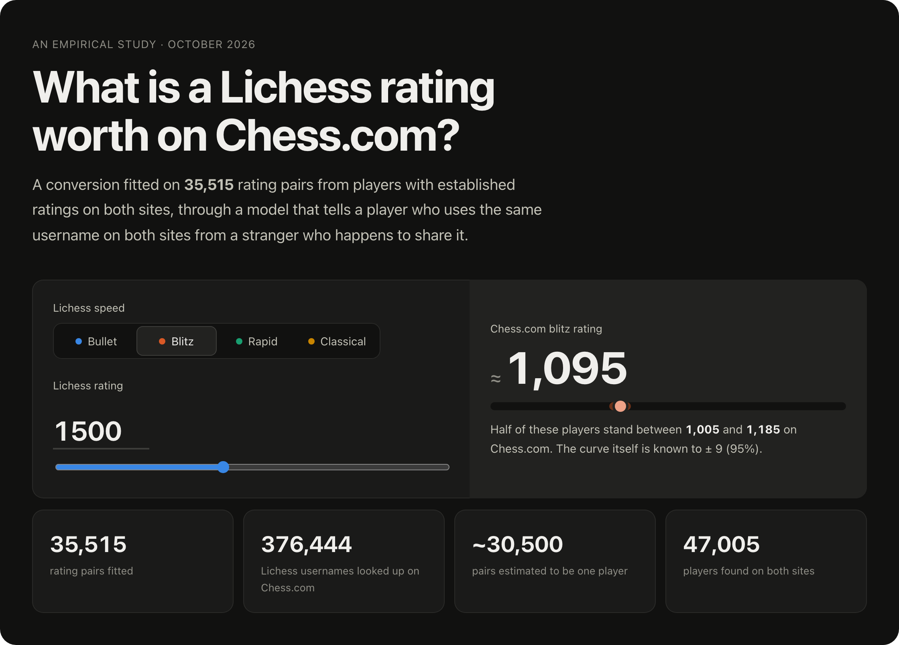
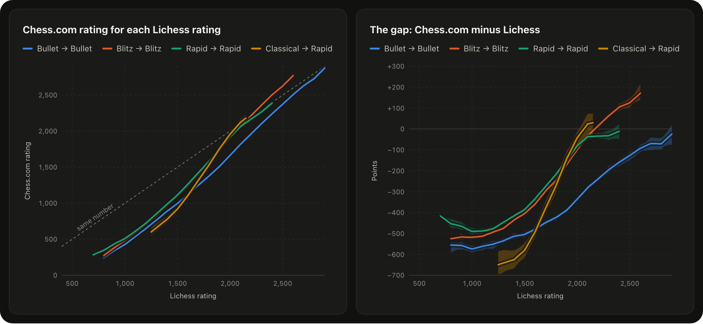
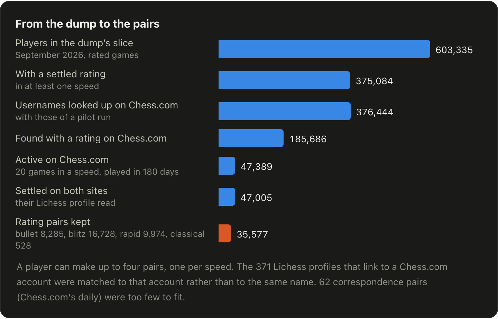
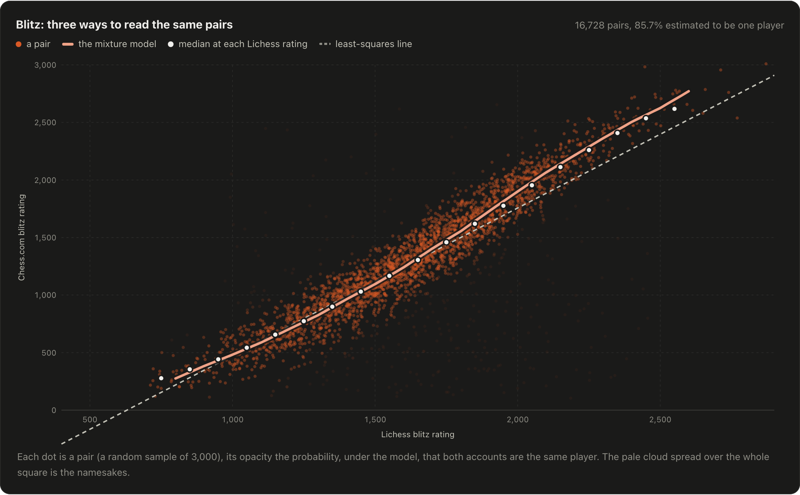
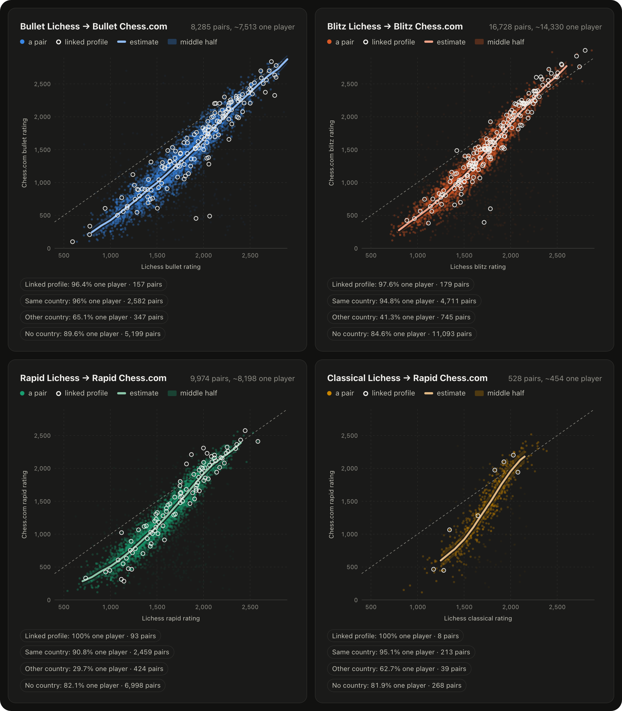
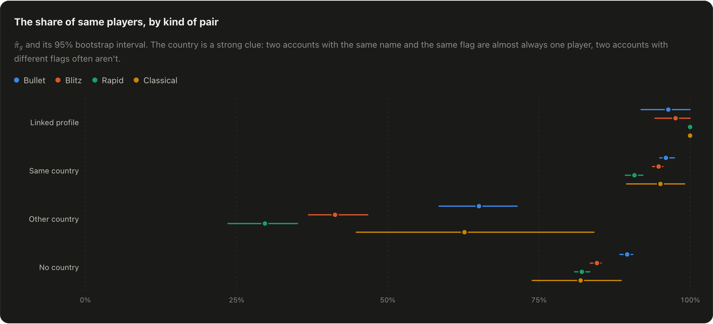
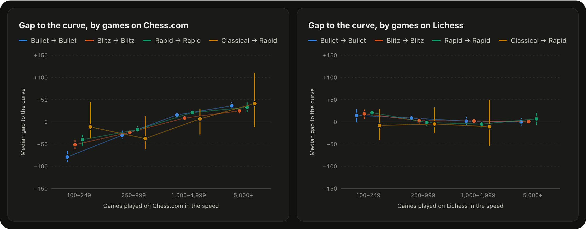
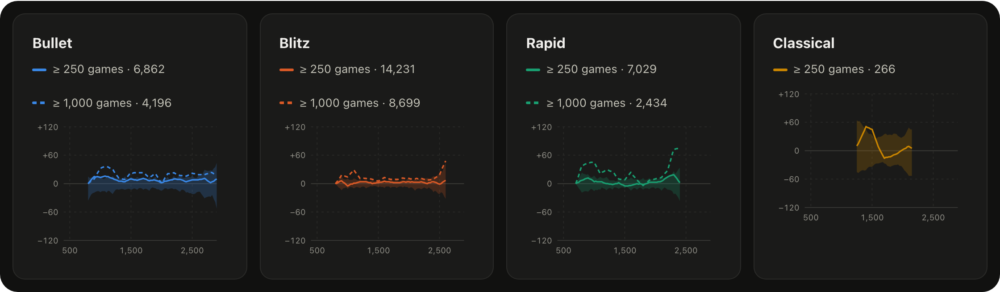
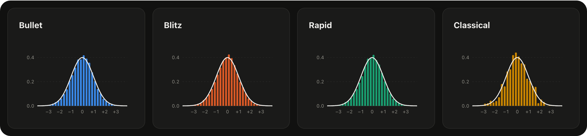

<p align="center">
  
</p>

<h1 align="center">What is a Lichess rating worth on Chess.com?</h1>

<p align="center">
  An empirical conversion, fitted on <b>35,515 rating pairs</b> from players with established ratings on both sites,
  <br>through a model that tells a player who uses the same username on both sites from a stranger who shares it.
</p>

<p align="center">
  <a href="https://theophile-wallez.github.io/lichess-chesscom-ratings/"></a>
  <a href="https://github.com/theophile-wallez/lichess-chesscom-ratings/releases/latest"></a>
  <a href="data/README.md"></a>
  <a href="LICENSE"></a>
</p>

<p align="center">
  <a href="https://theophile-wallez.github.io/lichess-chesscom-ratings/"><b>Paper and converter</b></a> ·
  <a href="#the-answer">The answer</a> ·
  <a href="#the-model">The model</a> ·
  <a href="#use-the-table">Use the table</a> ·
  <a href="#reproduce">Reproduce</a> ·
  <a href="#cite">Cite</a>
</p>

<a href="https://theophile-wallez.github.io/lichess-chesscom-ratings/"></a>

## The answer



- **Below about 2000, the same player is rated lower on Chess.com**, by 500 points and more for beginners.
- **The gap narrows as players get stronger.** In blitz it closes around 2170, then reverses: a 2600 on Lichess is
  about 2770 on Chess.com.
- **There is no single offset:** the gap depends on the speed and the level. Bullet's closes last: a 2800 on Lichess
  is still about 2730 on Chess.com.

The Chess.com rating of a Lichess rating, and ± the half range in which the middle half of players stand:

| Lichess | Bullet → Bullet | Blitz → Blitz | Rapid → Rapid | Classical → Rapid |
| ------: | --------------: | ------------: | ------------: | ----------------: |
|     800 |        245 ± 66 |      275 ± 56 |      347 ± 83 |                 – |
|   1,000 |        426 ± 83 |      482 ± 70 |      510 ± 78 |                 – |
|   1,200 |       648 ± 100 |      706 ± 88 |      723 ± 83 |                 – |
|   1,400 |       887 ± 109 |      964 ± 87 |      984 ± 83 |          774 ± 96 |
|   1,600 |     1,120 ± 112 |    1,240 ± 90 |    1,266 ± 97 |       1,107 ± 104 |
|   1,800 |     1,377 ± 110 |    1,554 ± 88 |    1,584 ± 98 |       1,530 ± 127 |
|   2,000 |     1,664 ± 103 |    1,900 ± 91 |    1,919 ± 80 |       1,957 ± 126 |
|   2,200 |     1,961 ± 100 |    2,215 ± 70 |    2,166 ± 70 |                 – |
|   2,400 |      2,241 ± 87 |    2,505 ± 71 |    2,389 ± 58 |                 – |
|   2,600 |      2,507 ± 78 |    2,771 ± 84 |             – |                 – |
|   2,800 |      2,729 ± 79 |             – |             – |                 – |

Every 50 points in [`data/conversion.csv`](data/conversion.csv) and [`data/conversion.json`](data/conversion.json).
Lichess's classical is compared with Chess.com's rapid, where those games are played. A rating is left out where
fewer than 25 players stand within 100 points of it.

## The data



Neither site says who has an account on the other, so the pairs have to be found.

1. **Players with a settled rating**, from a slice of Lichess's
   [open database](https://database.lichess.org) (September 2026).
2. **The same username on Chess.com**, through its
   [published-data API](https://www.chess.com/news/view/published-data-api), at a polite pace.
3. **Their Lichess profile**: current ratings, flag, and a link to a Chess.com account if it has one.
4. **The pairs**: one speed where both ratings rest on at least **100 games**, the Chess.com one with an RD of at
   most 90 and played in the last 90 days. The floor is on both sides, so a player with thousands of games on one
   site and a few dozen on the other is left out.

[`data/pairs.csv`](data/pairs.csv) holds the 35,577 pairs, with no usernames, countries or dates
([codebook](data/README.md)).

<br clear="right">

## The namesake problem

Most pairs are found through a shared username, and a username isn't a person: *alex* on Lichess and *alex* on
Chess.com are often two people. Their ratings have nothing to do with each other, and they flatten any plain average:
a least-squares line, or the median Chess.com rating at each Lichess rating, bends toward the middle at both ends.



Each dot is a pair, its opacity the model's probability that both accounts are one player. The pale cloud over the
whole square is the namesakes.

## The model

Each speed is fitted on its own, from its pairs $(x_i, y_i, g_i)$: the Lichess rating, the Chess.com rating, and the
kind of pair, which is a **link** (the Lichess profile links to the Chess.com account) or a shared username with the
**same country**, **other countries** or **no country** on the profiles.

**A mixture.** With $z_i = 1$ when both accounts are one player, $\Pr(z_i = 1) = \pi_{g_i}$. The same player's
Chess.com rating is normal around a curve $f$, a stranger's is drawn from $b$, the distribution of all the Chess.com
ratings found:

```math
p(y_i \mid x_i, g_i) \;=\; \pi_{g_i}\,\frac{1}{\sigma(x_i)}\,\varphi\!\left(\frac{y_i - f(x_i)}{\sigma(x_i)}\right) \;+\; \bigl(1 - \pi_{g_i}\bigr)\, b(y_i)
```

**A curve that can only rise.** $f$ is piecewise linear on knots every $h = 100$ points, each piece's slope a
softplus, so always positive:

```math
c_0 = \alpha, \qquad c_k = c_{k-1} + h\,\operatorname{softplus}(\beta_k), \qquad \operatorname{softplus}(u) = \log\bigl(1 + e^{u}\bigr)
```

The spread $\sigma$ is piecewise linear on knots every 400 points, through $e^{\gamma_j}$, and the shares go through a
logistic, $\pi_g = 1 / (1 + e^{-\delta_g})$. $b$ is a smoothed 25-point histogram of the speed's Chess.com ratings.

**The fit.** Penalized maximum likelihood, by L-BFGS-B from the least-squares line:

```math
\hat\theta \;=\; \arg\min_\theta \; -\sum_{i=1}^{n} \log p(y_i \mid x_i, g_i) \;+\; \lambda \sum_{k=1}^{K-1} \left(\frac{c_{k+1} - 2c_k + c_{k-1}}{h}\right)^{2}, \qquad \lambda = 2
```

**Which pairs are one player.** Bayes's rule gives each pair's probability, the `same_player_probability` column of
the data:

```math
w_i \;=\; \Pr(z_i = 1 \mid x_i, y_i, g_i) \;=\; \frac{\pi_{g_i}\, \sigma(x_i)^{-1} \varphi\bigl((y_i - f(x_i)) / \sigma(x_i)\bigr)}{p(y_i \mid x_i, g_i)}
```

**The table.** Every 50 points, $f(r)$ and $s(r)$, half the interquartile range of the gaps $y_i - f(x_i)$ of the
pairs within 100 points of $r$, each weighted by $w_i$. A 100-draw bootstrap gives the curve's 95% band.

The [paper](https://theophile-wallez.github.io/lichess-chesscom-ratings/#model) writes it all out. One caveat: the
curve estimates $\mathbb E[y \mid x]$, so read backward it doesn't give a Chess.com rating's Lichess equivalent.

## Speed by speed



The band holds the middle half of the players. The ringed dots are the pairs whose Lichess profile links to the
Chess.com account, the only ones known to be one player.



The country is a strong clue: two accounts with the same name and the same flag are almost always one player, two
with different flags often aren't.

## Checks

**The pairs known to be one player.** The model sees the links only through $\pi_{\text{link}}$. They sit a little
above the curve, more than chance gives in bullet and blitz, while the other kinds of pairs sit on it:

| Speed | Linked pairs | Median gap to the curve (95%) | Within the table's ± |
| ----- | -----------: | ----------------------------: | -------------------: |
| Bullet |         157 |                  +29 (+8, +59) |                  45% |
| Blitz  |         179 |                  +33 (+9, +56) |                  51% |
| Rapid  |          93 |                 +22 (−23, +43) |                  43% |

**Players rate higher where they play more.** At the same Lichess rating, a player with 5,000 games on Chess.com
stands 75 to 115 points above one with 200. Games played on Lichess matter much less. The curve is an average over the
sample's mix of players.



**More games, same curve.** Refitted on the pairs with at least 250 games on both sites, the curve moves by a few
points in blitz, at most 16 elsewhere. From 1,000 games it rises by 10 to 20 points, as the experience effect above
predicts.



**A normal spread.** The standardized gaps follow the standard normal closely: 69.5% of the weight within one
$\sigma$ (68.3% for the normal), 0.35% beyond three (0.27%).



The paper's [limits](https://theophile-wallez.github.io/lichess-chesscom-ratings/#limits) say what this sample can't
tell: who plays on both sites, and who links their accounts, isn't everyone.

## Use the table

[`data/conversion.json`](data/conversion.json) holds, per Lichess speed, rows of
`[Lichess rating, Chess.com rating, half the range of the middle half]` every 50 points. Between two rows, interpolate:

```python
import bisect, json

table = json.load(open("data/conversion.json"))["speeds"]

def chesscom(speed, rating):
    rows = table[speed]
    if not rows[0][0] <= rating <= rows[-1][0]:
        return None  # outside the range the data covers
    i = max(1, bisect.bisect_left([row[0] for row in rows], rating))
    (x0, y0, s0), (x1, y1, s1) = rows[i - 1], rows[i]
    t = (rating - x0) / (x1 - x0)
    return round(y0 + t * (y1 - y0)), round(s0 + t * (s1 - s0))

chesscom("blitz", 1500)  # (1095, 90): half of these players stand within 1,005 to 1,185
```

[Lichess Neo](https://github.com/theophile-wallez/LichessNeo), a browser extension for Lichess, uses this table to
show a rating's Chess.com equivalent.

## Reproduce

The analysis starts from the published pairs alone:

```sh
pip install -r analysis/requirements.txt
python3 analysis/analyze.py      # a few minutes: writes data/conversion.* and docs/results.json
python3 -m http.server -d docs   # the paper, on http://localhost:8000
```

<details>
<summary>The collection, about nine hours at a pace both APIs allow</summary>

```sh
dump=https://database.lichess.org/standard/lichess_db_standard_rated_2026-09.pgn.zst
curl -r 0-800000000 $dump | zstdcat | python3 collection/collect.py names - raw/names.jsonl
python3 collection/collect.py names-on-chesscom raw/names.jsonl raw/chesscom.jsonl
python3 collection/collect.py lichess raw/chesscom.jsonl raw/lichess.jsonl
python3 collection/collect.py links raw/lichess.jsonl raw/chesscom.jsonl
python3 collection/export.py raw   # writes data/pairs.csv and data/collection.json
```

Its raw output names the players, so it stays private: `data/pairs.csv` keeps no usernames, countries or dates, and
the games played only in ranges.

</details>

| Path          | What it holds                                                                            |
| ------------- | ---------------------------------------------------------------------------------------- |
| `data/`       | the pairs, the conversion table and the collection's counts ([codebook](data/README.md)) |
| `analysis/`   | the model (`model.py`) and the analysis (`analyze.py`), from `data/pairs.csv`            |
| `collection/` | the collection, from Lichess's dump and both sites' APIs                                 |
| `docs/`       | the paper, served by GitHub Pages, and the figures of this README                        |

## Cite

The code is under the [MIT license](LICENSE), the data under
[CC BY 4.0](https://creativecommons.org/licenses/by/4.0/). GitHub's "Cite this repository" button reads
[`CITATION.cff`](CITATION.cff), or:

```bibtex
@misc{wallez2026lichesschesscom,
  author = {Wallez, Th{\'e}ophile},
  title  = {What is a Lichess rating worth on Chess.com? An empirical conversion},
  year   = {2026},
  url    = {https://theophile-wallez.github.io/lichess-chesscom-ratings/},
  note   = {Version 1.0.0}
}
```

Not affiliated with Lichess or Chess.com.
