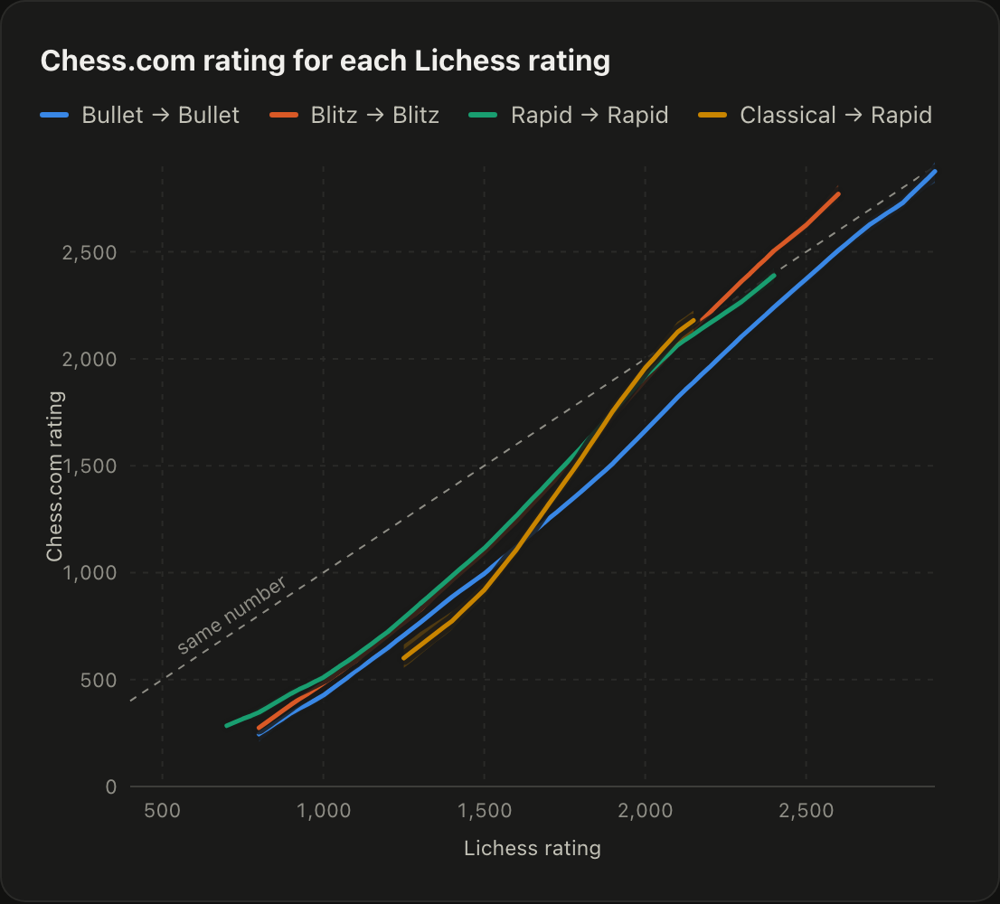

# What is a Lichess rating worth on Chess.com?

An empirical conversion from Lichess ratings to Chess.com ratings, fitted on
35,515 rating pairs from players with established ratings on both sites.

**Read the paper, with the charts, the maths and a converter:
<https://theophile-wallez.github.io/lichess-chesscom-ratings/>**



## The answer

The Chess.com rating of a Lichess rating, and ± the half range in which the
middle half of players stand (the full table, every 50 points, is in
[`data/conversion.csv`](data/conversion.csv)):

| Lichess | Bullet → Bullet | Blitz → Blitz | Rapid → Rapid | Classical → Rapid |
| ------: | --------------: | ------------: | ------------: | ----------------: |
| 800 | 245 ± 66 | 275 ± 56 | 347 ± 83 | – |
| 1,000 | 426 ± 83 | 482 ± 70 | 510 ± 78 | – |
| 1,200 | 648 ± 100 | 706 ± 88 | 723 ± 83 | – |
| 1,400 | 887 ± 109 | 964 ± 87 | 984 ± 83 | 774 ± 96 |
| 1,600 | 1,120 ± 112 | 1,240 ± 90 | 1,266 ± 97 | 1,107 ± 104 |
| 1,800 | 1,377 ± 110 | 1,554 ± 88 | 1,584 ± 98 | 1,530 ± 127 |
| 2,000 | 1,664 ± 103 | 1,900 ± 91 | 1,919 ± 80 | 1,957 ± 126 |
| 2,200 | 1,961 ± 100 | 2,215 ± 70 | 2,166 ± 70 | – |
| 2,400 | 2,241 ± 87 | 2,505 ± 71 | 2,389 ± 58 | – |
| 2,600 | 2,507 ± 78 | 2,771 ± 84 | – | – |
| 2,800 | 2,729 ± 79 | – | – | – |

Below about 2000, the same player is rated lower on Chess.com, by 500 points
and more for beginners. The gap narrows as players get stronger, and in blitz it
reverses at the top.

## How

1. **Collection** (`collection/`). A slice of Lichess's September 2026 dump
   of rated games gave 375,084 players with a settled rating. Each username
   was looked up on Chess.com's public API, and each active match's profile on
   Lichess's. A pair is one speed where both ratings rest on at least 100 games
   and the Chess.com one was played in the last 90 days.
2. **Model** (`analysis/model.py`). Most pairs are found by a shared
   username, and many are two different people. Per speed, a pair's Chess.com
   rating is a mixture: the same player's, normal around a rising curve of the
   Lichess rating, or a stranger's, drawn from all the Chess.com ratings found.
   The share of same players is fitted per kind of pair (linked profile, same
   country, other country, no country), by penalized maximum likelihood.
3. **Checks** (`analysis/analyze.py`). A 100-draw bootstrap for the curve's
   confidence band, the pairs known to be one player, the floor on games
   played, and the residuals' shape.

The [paper](https://theophile-wallez.github.io/lichess-chesscom-ratings/#model)
writes the model out in full, and says where it falls short.

## Reproduce

The analysis starts from the published pairs alone:

```sh
pip install -r analysis/requirements.txt
python3 analysis/analyze.py      # a few minutes: writes data/conversion.* and docs/results.json
python3 -m http.server -d docs   # the paper, on http://localhost:8000
```

The collection takes about nine hours, at a pace both APIs allow:

```sh
dump=https://database.lichess.org/standard/lichess_db_standard_rated_2026-09.pgn.zst
curl -r 0-800000000 $dump | zstdcat | python3 collection/collect.py names - raw/names.jsonl
python3 collection/collect.py names-on-chesscom raw/names.jsonl raw/chesscom.jsonl
python3 collection/collect.py lichess raw/chesscom.jsonl raw/lichess.jsonl
python3 collection/collect.py links raw/lichess.jsonl raw/chesscom.jsonl
python3 collection/export.py raw   # writes data/pairs.csv and data/collection.json
```

Its raw output names the players, so it stays private: `data/pairs.csv` keeps
no usernames, countries or dates, and the games played only in ranges.

## Repository

| Path          | What it holds                                                          |
| ------------- | ---------------------------------------------------------------------- |
| `data/`       | the pairs, the conversion table and the collection's counts ([codebook](data/README.md)) |
| `analysis/`   | the model and the analysis, from `data/pairs.csv`                      |
| `collection/` | the collection, from Lichess's dump and both sites' APIs               |
| `docs/`       | the paper, served by GitHub Pages                                      |

## License and citation

The code is under the [MIT license](LICENSE), the data under
[CC BY 4.0](https://creativecommons.org/licenses/by/4.0/). To cite it, see
[`CITATION.cff`](CITATION.cff).

Made for [Lichess Neo](https://github.com/theophile-wallez/LichessNeo), a
browser extension that can show a Lichess rating's Chess.com equivalent. Not
affiliated with Lichess or Chess.com.
